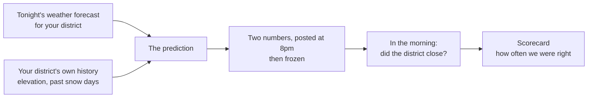

# Snow Day Predictor

The odds that a school district in New York's Southern Tier closes tomorrow
morning. Fifty districts across Broome, Chenango, Delaware, Greene, Otsego,
Schoharie and Tioga counties, from the Susquehanna valley up into the Catskills.

> **This is for fun.** It is not advice and it is not a reason to stay home from
> school. Your district decides, not this page.

## What it does

Every evening at 8pm, the site pulls a National Weather Service forecast for
each district's own patch of ground and posts two numbers for the next school
morning: the chance of a **full closure**, and the chance of **a delay or
worse**.

Then it freezes the 8pm number. It does not move again, and it is the one the
site's accuracy record is measured against. A second number keeps updating
through the night as the forecast changes, so you can watch it climb while it
snows outside. Both are on the page and both are labelled.

If a district actually announces, the announcement replaces the prediction. A
percentage sitting next to a district that has already said "closed" is worse
than showing nothing at all.



The accuracy record is right on the page instead of buried, because a prediction
tool that never shows its receipts is asking to be believed on trust.

## Why one district gets a higher number than another

Two districts can be under the same storm and still get different odds. Three
things drive most of the difference.

**Snow, obviously.** It is by far the biggest factor. But it does not work in a
straight line. Going from a clear road to three inches is most of the decision.
Going from twelve inches to fifteen barely matters, because by then the answer
was already yes.

**Where the district sits.** Higher districts close *less* often for the same
snow, which surprises most people. They have more plows for the roads they have
to clear, and a community that expects snow and is set up for it.

**Whether the district just used a snow day.** This is the strongest non-weather
factor in the whole thing. A district that closed two days ago is much less
likely to close again under the same storm, because snow days are a limited
supply and everyone knows it. Under six inches of snow, districts that had not
closed recently shut about 87% of the time. Districts that had closed in the
last three days shut about 32% of the time. Same snow.

There is one twist: on a *quiet* morning, having closed recently makes a closure
slightly more likely, not less, because it usually means the district is in a
rough stretch with snow still on the ground.

## How well it does

The predictions were tested against thirteen past winters, roughly 27,000 school
mornings. Two of those winters were held back completely and used only at the
end, so the model was graded on storms it had never seen.

Here is how the numbers line up with what actually happened:

| Snow overnight | How often districts really closed | What the model says |
|---|---|---|
| none | 0.4% | 0.5% |
| under 1 inch | 3% | 2% |
| 1 to 2 inches | 8% | 9% |
| 2 to 3 inches | 18% | 18% |
| 3 to 5 inches | 34% | 33% |
| 5 to 8 inches | 58% | 58% |
| over 8 inches | 83% | 85% |

Close, but not magic. In the 70%-and-up range it is a little overconfident: when
it says 84%, districts close about 75% of the time. Treat a high number as
"probably" and not as "definitely".

Worth remembering that school closings are rare, about 3 mornings out of every
100 all winter. Anything that just guessed "school is on" every single day would
be right most of the time and useless. The scorecard on the site measures
whether these predictions beat that.

## What it cannot do

**It does not know when the snow will stop.** Nine inches that ended at 10pm and
nine inches still falling at 8am are very different mornings, and only one of
them closes school. The site's second score, the hand-built one, does account
for this, which is why both numbers are shown.

**It is only as good as the forecast.** If the Weather Service expects six
inches and two show up, the prediction was wrong for a reason that has nothing
to do with the math.

**It knows nothing about your superintendent.** No local knowledge, no sense of
who is cautious and who is not, and no idea what the district next door is
doing, even though in real life superintendents talk to each other.

**It only calls the next school day.** On a Friday night it will name Monday,
but it will not put a number on it. Predicting three days out is a different
problem and it would be dishonest to score it the same way.

## Where the numbers come from

Everything the site runs on is public: forecasts and historical weather from the
National Weather Service and NOAA, district information from the federal
education statistics agency, district boundaries from the Census Bureau, ground
elevation from the US Geological Survey, and live closing announcements from the
WBNG feed.

No personal information of any kind is collected, used or published. Nothing
here is about any student, family, or staff member. It is weather, terrain, and
public records of which days schools were closed.

Each district gets its own blend of the nearest snow-reporting stations rather
than one regional airport, which matters more than it sounds like it should.
These districts span about 110 miles and 2,100 feet of elevation. Binghamton
airport has nothing useful to say about Hunter-Tannersville, 90 miles away and
1,260 feet higher up.

## More detail

[`model/MODEL-CARD.md`](model/MODEL-CARD.md) is the technical version: exactly
what the model looks at, how it was trained and tested, the full accuracy
tables, and an honest list of its weak spots. Written for someone who wants to
check the work rather than take it on faith.

## Running it yourself

```powershell
python -m venv .venv
.venv\Scripts\Activate.ps1
pip install -r requirements.txt
streamlit run app\snowday.py
```

| Path | What lives there |
|---|---|
| `app/` | The page, the map, and the wording |
| `collect/` | The jobs that fetch forecasts, weather history and closings |
| `model/` | The prediction itself and the scorecard |
| `reference/` | District list, station assignments, boundaries |
| `data/` | Forecast archive, frozen calls, outcomes |

Tests: `python -m pytest model/ collect/ app/ -q`

In August the site correctly reports well under a 1% chance of a snow day and
the scorecard is empty. Both are the right answer.

## Credits

Built at the South Central Regional Information Center.

Forecasts and historical observations come from the National Weather Service and
NOAA. District geography comes from the NCES Common Core of Data, the Census
Bureau's TIGER files and USGS 3DEP. Live closing announcements come from the
WBNG feed.
